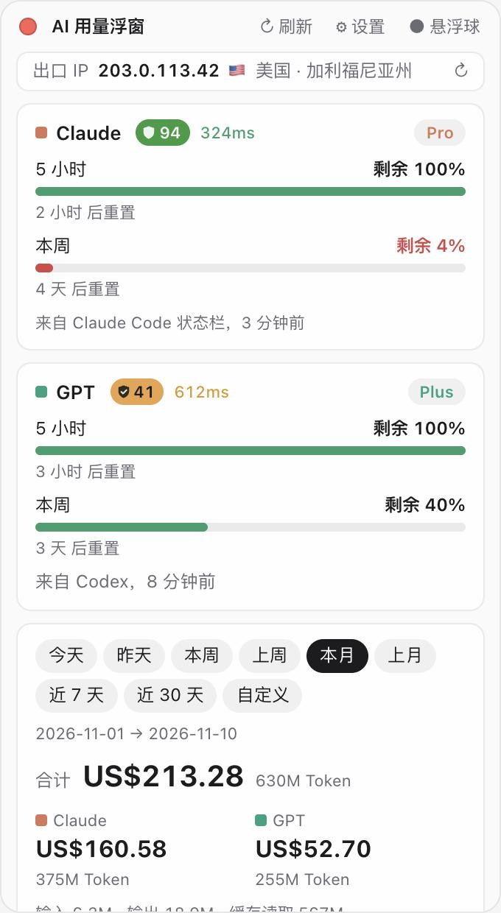

# Usage Float

[简体中文](README.md) · **English** · [繁體中文](README.zh-Hant.md)

<p>
  <a href="https://github.com/xiaoxing1617/usage-float/stargazers"></a>
  
  <a href="LICENSE"></a>
</p>

> ⭐ **If this little tool helps you, please give it a Star (top right)!** Every star keeps me going and helps others find it.


A small floating widget for your Mac desktop that keeps your **Claude** and **GPT (Codex)** usage in view: remaining quota, reset times, plan, usage by period, and what it would cost at API prices (USD / CNY / JPY / SGD / EUR).

> [!IMPORTANT]
> **macOS only** (macOS 11 Big Sur or later, Apple silicon or Intel). Windows, Linux, iPhone and iPad are not supported.

<p align="center">
  
  &nbsp;&nbsp;
  
</p>

<sub>Screenshots show demo data.</sub>

## Features

- **Remaining quota**: 5-hour and weekly windows for Claude and GPT, with percentage left and reset countdown.
- **Plan**: Pro / Max / Plus and so on.
- **Usage stats**: today, yesterday, this week, last week, this month, last month, last 7 days, last 30 days, or a custom range; broken down by model and by day.
- **Cost estimate (optional)**: with "Fetch model prices automatically" on, prices are refreshed every 12 hours from the [LiteLLM price table](https://github.com/BerriAI/litellm). Every price change is kept, and each usage event is priced at the rate **in effect at that time** (if a model cost $5 yesterday and $3 today, each day is priced separately). With it off, no cost is shown.
- **Currencies**: USD, CNY, JPY, SGD, EUR, with ECB rates from [Frankfurter](https://frankfurter.dev).
- **Floating ball**: shrink to a small ball, Claude on the left and GPT on the right; the outer ring is the 5-hour quota, the inner ring the weekly quota. Click to expand, drag to move.
- **Public IP**: the egress IP websites see, with country and state/province (in the UI language).
- **IP trust score & latency**: a 🛡 score (0–100, red to green) and latency in ms next to the Claude and GPT names. Click the score for the full IP check; click the latency to see how it is measured.
- **Three languages**: English, 简体中文, 繁體中文. Picked from the system language on first launch, falling back to English; change it in Settings.
- **Theme**: Auto (follow system), Light or Dark, Auto by default; optional "always on top".

## Requirements

| | |
| --- | --- |
| Computer | A Mac with Apple silicon (M1 or later) or Intel |
| System | macOS 11 Big Sur or later |
| Usage data | [Claude Code](https://docs.claude.com/en/docs/claude-code) (CLI / IDE extension) and/or [Codex](https://github.com/openai/codex) used on this Mac. The widget reads the logs they keep locally |
| To build from source | Xcode Command Line Tools, Rust 1.77.2+, Node.js 20.19+ or 22.12+; about 3 GB of disk space and 5–15 minutes for the first build |

> [!NOTE]
> Only usage from **Claude Code** and **Codex** is counted. Chats on claude.ai, the Claude desktop app or ChatGPT aren't written to local logs, so they are not in the stats (they share the same quota, though, so the quota percentages are accurate).

## Install

### Option 1: one sentence to your AI agent (recommended)

If **Claude Code** or **Codex** is already on your Mac, run `claude` or `codex` in Terminal and send it this:

```text
Please install Usage Float on this Mac: https://github.com/xiaoxing1617/usage-float
Steps: first check this is macOS 11 or later (if it isn't a Mac, stop and tell me); install whatever is missing: Xcode Command Line Tools, Rust (official rustup installer), Node.js 22 LTS; clone the repo to ~/usage-float, run npm install and npm run tauri build -- --bundles app; copy src-tauri/target/release/bundle/macos/Usage Float.app to /Applications and open it. Don't change anything else on my computer, and tell me before working around any problem.
```

When it's done, the widget's icon appears in the menu bar.

### Option 2: build from source yourself

1. Install the Xcode Command Line Tools:

   ```bash
   xcode-select --install
   ```

2. Install Rust:

   ```bash
   curl --proto '=https' --tlsv1.2 -sSf https://sh.rustup.rs | sh
   ```

3. Install Node.js 22 LTS (from [nodejs.org](https://nodejs.org), or with Homebrew: `brew install node@22`).

4. Download and build:

   ```bash
   git clone https://github.com/xiaoxing1617/usage-float.git
   cd usage-float
   npm install
   npm run tauri build -- --bundles app
   ```

5. Move the app to Applications and open it:

   ```bash
   cp -R "src-tauri/target/release/bundle/macos/Usage Float.app" /Applications/
   open "/Applications/Usage Float.app"
   ```

### Option 3: download a build

Download the latest `Usage-Float_x.y.z_universal.dmg` (Apple silicon and Intel) from [Releases](https://github.com/xiaoxing1617/usage-float/releases/latest), open it and drag the app into Applications. This is the easiest way if you don't want to install developer tools.

The app isn't signed with an Apple Developer ID, so macOS blocks it the first time. To open it: in Finder, **right-click the app → Open → Open**. If there's no Open button, go to **System Settings → Privacy & Security**, scroll down and click **Open Anyway**.

## Usage

- **Show / hide**: click the menu bar icon. The app has no Dock icon.
- **Move**: drag the title bar; drag the ball directly.
- **Red dot (top left)**: hide the widget (reopen it from the menu bar icon).
- **Top right**: `↻ Refresh`, `⚙ Settings`, `● Ball`.
- **Start at login**: add Usage Float under **System Settings → General → Login Items**.

### Getting the Claude quota (important)

The GPT quota is read straight from the Codex logs. **The Claude quota needs the Claude Code status line**:

1. In the widget, open **Settings → Claude Code status line (recommended) → Connect Claude Code status line**. This points the status line in `~/.claude/settings.json` at a small script (the file is backed up first, and any status line you already had keeps showing).
2. Use Claude Code once in Terminal (run `claude` and send a message).
3. The widget now shows the 5-hour and weekly quota "from the Claude Code status line". It updates whenever you use Claude Code in a terminal or IDE.

> The Claude desktop app and claude.ai don't run the status line; only Claude Code in a terminal or IDE does.
> Settings also has an optional "Claude remaining quota (unofficial)" switch that reads your sign-in from the Keychain and calls an unofficial endpoint. It is often rate-limited, so you usually don't need it.

To undo: click **Disconnect** in Settings; `settings.json` is restored exactly.

### Cost and prices

Cost only appears after you turn on **Fetch model prices automatically**. It is an estimate at public API prices, **not what you are actually charged** (subscriptions are billed monthly). Models missing from the price table are priced like the same family, and usage from before the first price record uses the earliest known price; both cases are marked with `*`.

## Privacy

**Your usage logs, conversations, accounts and keys are only read on your Mac and never uploaded.**

The widget only connects to these addresses, and all of them except exchange rates can be turned off in Settings:

| Purpose | Address | What is sent |
| --- | --- | --- |
| Model prices (optional) | raw.githubusercontent.com (LiteLLM price table) | nothing |
| Exchange rates | api.frankfurter.dev | nothing |
| Public IP and location (optional) | Cloudflare `cdn-cgi/trace`, api.ipify.org, ipwho.is | your public IP (which they see anyway) |
| Trust score and latency (optional) | `cdn-cgi/trace` on claude.ai and chatgpt.com, ip.net.coffee | your public IP |
| Claude quota endpoint (off by default) | api.anthropic.com | Claude Code's sign-in token, sent only to Anthropic |

Files it writes on your Mac:

- `~/.claude/settings.json` (only when you connect the status line; backed up first to `settings.json.usage-float.bak`)
- `~/.claude/usage-float/` (the status line script and the latest quota data)
- `~/Library/Application Support/com.usagefloat.app/` (price history, cache)

## Uninstall

1. If you connected the status line, click **Disconnect** in Settings first.
2. Quit the app (menu bar icon → Quit) and delete `/Applications/Usage Float.app`.
3. Optional: delete `~/.claude/usage-float/` and `~/Library/Application Support/com.usagefloat.app/`.

## Development

```bash
npm install
npm run tauri dev      # run the app in development mode
npm run dev            # UI only, in a browser, with demo data
npm run tauri build    # build the .app / .dmg
cd src-tauri && cargo test
```

Stack: Tauri 2 · Rust · React · TypeScript.

## Changelog

What each version added, improved and fixed: [CHANGELOG.md](CHANGELOG.md).

## License

[MIT](LICENSE): free to use, modify, sell and redistribute, as long as the copyright notice is kept.

## Disclaimer

This is a personal open-source project, not affiliated with Anthropic, OpenAI or ip.net.coffee. Quotas, prices and scores come from public or unofficial sources and are for reference only.
