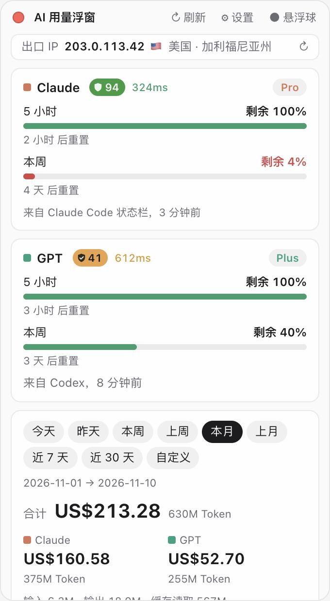

# Usage Float · AI 用量浮窗

**简体中文** · [English](README.en.md) · [繁體中文](README.zh-Hant.md)

<p>
  <a href="https://github.com/xiaoxing1617/usage-float/stargazers"></a>
  
  
  <a href="LICENSE"></a>
</p>

> ⭐ **如果这个小工具对你有帮助，请点一下右上角的 Star 支持一下！** 你的每一个 Star 都是我继续更新的动力，也能让更多人发现它。也可以[请作者喝杯咖啡 ☕](#支持作者)。


一个常驻在 Mac 桌面上的小浮窗，帮你随时看到 **Claude** 和 **ChatGPT（Codex）** 的用量：还剩多少额度、什么时候重置、会员等级、按时间段统计的用量，以及折合多少钱（美元 / 人民币 / 日元 / 新币 / 欧元）。

> [!IMPORTANT]
> | 平台 | 状态 |
> | --- | --- |
> | **macOS** 11 Big Sur 或更新（Apple 芯片 / Intel） | ✅ **开发者亲测，日常在用** |
> | **Windows** 10 / 11（64 位） | 🧪 **已提供安装包，有待验证**：代码已适配，由 GitHub 云端自动编译，但开发者还没有在 Windows 电脑上实际测试过。遇到问题欢迎提 [Issue](https://github.com/xiaoxing1617/usage-float/issues) |
>
> 不支持 Linux、iPhone、iPad、安卓。

<p align="center">
  
  &nbsp;&nbsp;
  
</p>

<sub>截图里是演示数据。</sub>

## 功能

- **剩余额度**：Claude 和 ChatGPT 的 5 小时额度、每周额度，剩余百分比和重置倒计时。
- **会员等级**：Pro / Max / Plus 等。
- **用量统计**：今天、昨天、本周、上周、本月、上月、近 7 天、近 30 天、自定义日期；按模型、按天分别统计。
- **费用估算（可选）**：打开“自动获取模型价格”后，每 12 小时从 [LiteLLM 价格表](https://github.com/BerriAI/litellm) 更新一次价格。每次价格变化都会记录下来，每条用量按**当时的价格**计算（比如某模型昨天 $5、今天 $3，会分开算）。不打开就不显示费用。
- **货币换算**：美元、人民币、日元、新加坡元、欧元，汇率来自欧洲央行（[Frankfurter](https://frankfurter.dev)）。
- **悬浮球**：缩小成一个圆球，左边 Claude、右边 ChatGPT；外圈是 5 小时额度，内圈是周额度。点一下展开，按住可拖动。有对话正在进行时，球上会出现数字角标（Claude Code / Codex 正在进行的对话数量），带轻微的波纹动画。旁边会弹出气泡，列出每个任务的标题和已进行时间；点气泡底部的“收起”可以隐藏，再点数字就重新展开，Claude 和 ChatGPT 分别记住。完成的任务会留在列表的“已完成”里，点 × 移除；点任务这一行就能打开对应的对话（Codex 和 Claude 桌面版）。
- **出口 IP**：显示网站看到的公网出口 IP，以及国家和省 / 州（跟随界面语言）。
- **IP 信任评分和延迟**：在 Claude、ChatGPT 名称后面显示 🛡 评分（0–100，颜色从红到绿）和延迟毫秒数。点评分打开完整检测页，点毫秒数查看延迟是怎么测的。
- **三种语言**：简体中文、繁體中文、English。首次打开时按系统语言自动选择，其他语言默认用英文；可以在设置里改。
- **主题**：自动（跟随系统）、浅色、暗色，默认自动；可设置“始终置顶”。

## 设备和系统要求

| 项目 | 要求 |
| --- | --- |
| 电脑 | Mac（Apple 芯片 M1 及以后，或 Intel）；或 64 位 Windows 电脑（有待验证） |
| 系统 | macOS 11 Big Sur 或更新；Windows 10 / 11（需要 WebView2，Windows 11 自带，Windows 10 一般也已装好） |
| 用量数据 | 这台 Mac 上用过 [Claude Code](https://docs.claude.com/en/docs/claude-code)（命令行 / IDE 插件）和 / 或 [Codex](https://github.com/openai/codex)。浮窗读取它们留在本机的记录 |
| 从源码安装时 | Rust 1.77.2+、Node.js 20.19+ 或 22.12+；Mac 需要 Xcode 命令行工具，Windows 需要 Visual Studio 生成工具（“使用 C++ 的桌面开发”）；约 3 GB 磁盘空间，首次编译约 5–15 分钟 |

> [!NOTE]
> 只统计 **Claude Code** 和 **Codex** 产生的用量。claude.ai 网页、Claude 桌面版、ChatGPT 网页 / App 的对话不会写到本机记录里，所以不计入统计（但它们和 Claude Code 共用同一份额度，额度百分比是准的）。

## 安装

### 方法一：一句话让 AI 帮你装（推荐，Mac）

如果你的 Mac 上已经装了 **Claude Code** 或 **Codex**，打开终端运行 `claude` 或 `codex`，把下面这段话发给它：

```text
请帮我在这台 Mac 上安装 Usage Float：https://github.com/xiaoxing1617/usage-float
步骤：先确认这是 macOS 11 或更新的系统（不是 Mac 就停止并告诉我）；缺什么就装什么：Xcode 命令行工具、Rust（用 rustup 官方安装）、Node.js 22 LTS；把仓库克隆到 ~/usage-float，运行 npm install 和 npm run tauri build -- --bundles app；把 src-tauri/target/release/bundle/macos/Usage Float.app 复制到 /Applications 并打开。除此之外不要修改我电脑上的其他东西，每一步遇到问题先告诉我。
```

装好后菜单栏会出现浮窗图标。

### 方法二：自己从源码编译

1. 安装 Xcode 命令行工具：

   ```bash
   xcode-select --install
   ```

2. 安装 Rust：

   ```bash
   curl --proto '=https' --tlsv1.2 -sSf https://sh.rustup.rs | sh
   ```

3. 安装 Node.js 22 LTS（从 [nodejs.org](https://nodejs.org) 下载，或用 Homebrew：`brew install node@22`）。

4. 下载并编译：

   ```bash
   git clone https://github.com/xiaoxing1617/usage-float.git
   cd usage-float
   npm install
   npm run tauri build -- --bundles app
   ```

5. 把编译好的 app 放进“应用程序”并打开：

   ```bash
   cp -R "src-tauri/target/release/bundle/macos/Usage Float.app" /Applications/
   open "/Applications/Usage Float.app"
   ```

### 方法三：下载安装包

到 [Releases](https://github.com/xiaoxing1617/usage-float/releases/latest) 下载最新版本。不想装开发工具的话，这是最简单的方式。

| 电脑 | 下载哪个文件 |
| --- | --- |
| Mac | `Usage-Float_x.y.z_universal.dmg`（Apple 芯片和 Intel 通用），打开后把 app 拖进“应用程序” |
| Windows（有待验证） | `Usage.Float_x.y.z_x64-setup.exe`（推荐）或 `Usage.Float_x.y.z_x64_en-US.msi`，双击安装 |

这个 app 没有开发者签名，第一次打开时系统会拦截：

- **Mac**：在 Finder 里**右键点 app → 打开 → 打开**；如果没有“打开”按钮，去“系统设置 → 隐私与安全性”，往下找到它点“仍要打开”。
- **Windows**：出现“Windows 已保护你的电脑”时，点 **更多信息 → 仍要运行**。

## 使用

- **显示 / 隐藏**：点菜单栏的图标（Windows 上是右下角系统托盘的图标）。app 不在程序坞 / 任务栏里显示。
- **移动**：按住标题栏拖动；悬浮球直接按住拖动。
- **左上角红点**：隐藏浮窗（从菜单栏图标重新打开）。
- **右上角**：`↻ 刷新`、`⚙ 设置`、`● 悬浮球`。
- **检查更新**：设置页最上方显示当前版本和 GitHub 仓库地址，点「检查更新」即可；有新版本时点「立即更新」，会自动下载、安装并重启（默认每天自动检查两次，可关闭）。
- **开机自动启动**：Mac 在“系统设置 → 通用 → 登录项”里添加 Usage Float；Windows 按 `Win + R` 输入 `shell:startup`，把 Usage Float 的快捷方式放进去。

### Claude 额度从哪里来

ChatGPT 的额度会直接从 Codex 记录里读到。Claude 的额度默认这样获取：

**用 `/usage` 读取（默认开启，推荐）**：浮窗每 10 分钟在后台运行一次 Claude Code 自带的 `/usage` 命令（`claude -p "/usage" --no-session-persistence`），读出 5 小时、每周和按模型的额度。这是本地命令，**不聊天、不消耗 token、不花钱**，也不会在你的会话历史里留下记录。只需要这台 Mac 上装好并登录了 Claude Code 命令行版。

如果 `/usage` 用不了，也可以接入 Claude Code 的状态栏：

1. 打开浮窗 **设置 → Claude Code 状态栏（推荐）→ 连接 Claude Code 状态栏**。浮窗会在 `~/.claude/settings.json` 里设置一个状态栏脚本（会先备份原文件，之前的状态栏会照常显示）。
2. 在终端里用一次 Claude Code（运行 `claude` 并发一条消息）。
3. 浮窗就会显示“来自 Claude Code 状态栏”的 5 小时和每周额度。之后每次在终端或 IDE 里用 Claude Code 都会自动更新。

有多个来源时，浮窗自动用最新的那一个。

> Claude 桌面版和网页版不会触发状态栏，只有命令行 / IDE 版的 Claude Code 会。
> 设置里还有一个可选的“Claude 剩余额度（非官方）”开关，会从钥匙串读取登录信息去调用非官方接口，经常被限流，一般不需要打开。

断开：设置里点“断开”，会把 `settings.json` 恢复成原来的样子。

### 费用和价格

设置里打开 **自动获取模型价格** 后才会显示费用。费用是按 API 公开价格估算的“等值金额”，**不是你实际被扣的钱**（订阅用户按月付费）。价格表里没有的模型会按同系列模型估算，早于第一次价格记录的用量会用最早的价格补算，这两种情况都用 `*` 标出。

## 隐私

**你的用量记录、会话内容、账号和密钥都只在本机读取，不会上传到任何地方。**

浮窗只会联网访问下面这些地址，都可以在设置里关闭（汇率除外）：

| 用途 | 访问的地址 | 发送的内容 |
| --- | --- | --- |
| 模型价格（可关） | raw.githubusercontent.com（LiteLLM 价格表） | 无 |
| 汇率 | api.frankfurter.dev | 无 |
| 出口 IP 和位置（可关） | Cloudflare `cdn-cgi/trace`、api.ipify.org、ipwho.is | 你的公网 IP（对方本来就能看到） |
| 信任评分和延迟（可关） | claude.ai、chatgpt.com 的 `cdn-cgi/trace`，ip.net.coffee | 你的公网 IP |
| Claude 额度（`/usage`，可关） | 由 Claude Code 自己访问 Anthropic | 浮窗本身不发送任何内容，也不读取登录令牌 |
| Claude 额度接口（默认关） | api.anthropic.com | Claude Code 的登录令牌，只发给 Anthropic 官方 |

会写入的本机文件：

- `~/.claude/settings.json`（只在你点“连接状态栏”时修改，修改前备份为 `settings.json.usage-float.bak`）
- `~/.claude/usage-float/`（状态栏脚本和最新额度数据）
- `~/Library/Application Support/com.usagefloat.app/`（价格历史、缓存；Windows 上是 `%APPDATA%\com.usagefloat.app\`）

“正在进行的对话”只读取 `~/.claude/projects` 和 `~/.codex/sessions` 里最近几分钟写过的记录文件的末尾，用来判断对话是否结束，不会上传任何内容。

## 支持作者

这个项目完全免费、开源，是我利用业余时间做的。如果它帮你省了时间、你也愿意支持一下，可以用支付宝或微信扫码请我喝杯咖啡 ☕。金额随意，**完全自愿**，不打赏也能正常使用全部功能；点一个 ⭐ Star 同样是很大的鼓励。

<p align="center">
  
</p>

## 加入交流群

想聊聊 Claude Code / Codex / AI 编程的使用心得、反馈问题、提新功能，或者只是想认识一群爱折腾的朋友？欢迎扫码加我微信，我拉你进群 👇

- 💬 **技术交流群**：Usage Float 使用问题、Bug 反馈、新功能建议，新版本第一时间通知
- 🚀 **大佬交流群**：AI 编程、独立开发、效率工具的深度玩家，聊实战经验和最新玩法
- 📚 **学习交流群**：刚接触 Claude / ChatGPT / AI 编程也没关系，一起学习、互相答疑

> 加好友时请**备注来意**，例如「Usage Float + 技术交流」「Usage Float + 学习交流」，方便我通过并拉你进对应的群；没有备注的申请可能会被当作广告忽略。群里禁止广告和引流，大家友好交流 🙌

<p align="center">
  
</p>

## 卸载

1. 如果连接过状态栏，先在设置里点 **断开**。
2. 退出 app（菜单栏 / 系统托盘图标 → Quit）。Mac 删除 `/Applications/Usage Float.app`；Windows 在“设置 → 应用”里卸载 Usage Float。
3. 可选：删除 `~/.claude/usage-float/`，以及 `~/Library/Application Support/com.usagefloat.app/`（Windows 上是 `%APPDATA%\com.usagefloat.app\`）。

## 开发

```bash
npm install
npm run tauri dev      # 运行 app（开发模式）
npm run dev            # 只在浏览器里看界面，使用演示数据
npm run tauri build    # 打包 .app / .dmg
cd src-tauri && cargo test
```

技术栈：Tauri 2 · Rust · React · TypeScript。

Windows 安装包由 GitHub Actions（[`.github/workflows/windows.yml`](.github/workflows/windows.yml)）在 Windows 云端机器上自动编译：每次发布版本标签（`v*`）都会把 `.exe` 和 `.msi` 附加到对应的 Release，也可以在 Actions 页面手动运行。

## 更新日志

每个版本修复了什么、加了什么、优化了什么，见 [CHANGELOG.md](CHANGELOG.md)。

## 开源协议

[MIT](LICENSE)：可以免费使用、修改、商用和再发布，只需保留版权声明。

## 声明

本项目是个人开源项目，与 Anthropic、OpenAI、ip.net.coffee 没有任何关联。额度、价格、评分都来自公开或非官方的数据源，仅供参考。
