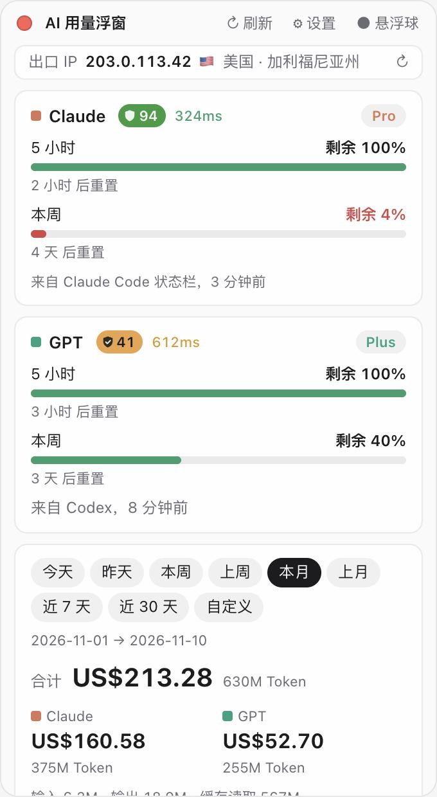

# Usage Float · AI 用量浮窗

[简体中文](README.md) · [English](README.en.md) · **繁體中文**

<p>
  <a href="https://github.com/xiaoxing1617/usage-float/stargazers"></a>
  
  <a href="LICENSE"></a>
</p>

> ⭐ **如果這個小工具對你有幫助，請點一下右上角的 Star 支持一下！** 你的每一個 Star 都是我持續更新的動力，也能讓更多人發現它。


一個常駐在 Mac 桌面上的小浮窗，讓你隨時看到 **Claude** 和 **GPT（Codex）** 的用量：還剩多少額度、什麼時候重置、會員等級、依時間區間統計的用量，以及換算成多少錢（美元／人民幣／日圓／新幣／歐元）。

> [!IMPORTANT]
> **僅支援 macOS**（macOS 11 Big Sur 或更新版本，Apple 晶片與 Intel 皆可）。不支援 Windows、Linux、iPhone、iPad。

<p align="center">
  
  &nbsp;&nbsp;
  
</p>

<sub>截圖中為示範資料。</sub>

## 功能

- **剩餘額度**：Claude 和 GPT 的 5 小時額度、每週額度，剩餘百分比與重置倒數。
- **會員等級**：Pro／Max／Plus 等。
- **用量統計**：今天、昨天、本週、上週、本月、上月、近 7 天、近 30 天、自訂日期；依模型、依天分別統計。
- **費用估算（選用）**：開啟「自動取得模型價格」後，每 12 小時從 [LiteLLM 價格表](https://github.com/BerriAI/litellm) 更新一次。每次價格變動都會保留紀錄，每筆用量依**當時的價格**計算（例如某模型昨天 $5、今天 $3，會分開計算）。未開啟則不顯示費用。
- **幣別換算**：美元、人民幣、日圓、新加坡幣、歐元，匯率來自歐洲央行（[Frankfurter](https://frankfurter.dev)）。
- **懸浮球**：縮小成一顆圓球，左邊 Claude、右邊 GPT；外圈是 5 小時額度，內圈是週額度。點一下展開，按住可拖曳。
- **出口 IP**：顯示網站看到的公網出口 IP，以及國家和州／省（跟隨介面語言）。
- **IP 信任評分與延遲**：在 Claude、GPT 名稱後面顯示 🛡 評分（0–100，顏色由紅到綠）與延遲毫秒數。點評分開啟完整檢測頁，點毫秒數查看延遲是怎麼測的。
- **三種語言**：繁體中文、简体中文、English。首次開啟時依系統語言自動選擇，其他語言預設為英文；可在設定中更改。
- **主題**：自動（跟隨系統）、淺色、深色，預設自動；可設定「永遠置頂」。

## 裝置與系統需求

| 項目 | 需求 |
| --- | --- |
| 電腦 | Mac（Apple 晶片 M1 以後，或 Intel） |
| 系統 | macOS 11 Big Sur 或更新版本 |
| 用量資料 | 這台 Mac 上用過 [Claude Code](https://docs.claude.com/en/docs/claude-code)（命令列／IDE 外掛）和／或 [Codex](https://github.com/openai/codex)。浮窗讀取它們留在本機的紀錄 |
| 從原始碼安裝時 | Xcode 命令列工具、Rust 1.77.2+、Node.js 20.19+ 或 22.12+；約 3 GB 磁碟空間，首次編譯約 5–15 分鐘 |

> [!NOTE]
> 只統計 **Claude Code** 和 **Codex** 產生的用量。claude.ai 網頁、Claude 桌面版、ChatGPT 網頁／App 的對話不會寫入本機紀錄，因此不列入統計（但它們與 Claude Code 共用同一份額度，額度百分比是準確的）。

## 安裝

### 方法一：一句話讓 AI 幫你裝（推薦）

如果你的 Mac 上已經裝了 **Claude Code** 或 **Codex**，打開終端機執行 `claude` 或 `codex`，把下面這段話傳給它：

```text
請幫我在這台 Mac 上安裝 Usage Float：https://github.com/xiaoxing1617/usage-float
步驟：先確認這是 macOS 11 或更新的系統（不是 Mac 就停止並告訴我）；缺什麼就裝什麼：Xcode 命令列工具、Rust（用 rustup 官方安裝）、Node.js 22 LTS；把儲存庫 clone 到 ~/usage-float，執行 npm install 和 npm run tauri build -- --bundles app；把 src-tauri/target/release/bundle/macos/Usage Float.app 複製到 /Applications 並開啟。除此之外不要修改我電腦上的其他東西，每一步遇到問題先告訴我。
```

裝好後選單列會出現浮窗圖示。

### 方法二：自行從原始碼編譯

1. 安裝 Xcode 命令列工具：

   ```bash
   xcode-select --install
   ```

2. 安裝 Rust：

   ```bash
   curl --proto '=https' --tlsv1.2 -sSf https://sh.rustup.rs | sh
   ```

3. 安裝 Node.js 22 LTS（從 [nodejs.org](https://nodejs.org) 下載，或用 Homebrew：`brew install node@22`）。

4. 下載並編譯：

   ```bash
   git clone https://github.com/xiaoxing1617/usage-float.git
   cd usage-float
   npm install
   npm run tauri build -- --bundles app
   ```

5. 把編譯好的 app 放進「應用程式」並開啟：

   ```bash
   cp -R "src-tauri/target/release/bundle/macos/Usage Float.app" /Applications/
   open "/Applications/Usage Float.app"
   ```

### 方法三：下載安裝檔

到 [Releases](https://github.com/xiaoxing1617/usage-float/releases/latest) 下載最新的 `Usage-Float_x.y.z_universal.dmg`（Apple 晶片與 Intel 通用），開啟後把 app 拖進「應用程式」。不想安裝開發工具的話，這是最簡單的方式。

這個 app 沒有 Apple 開發者簽章，第一次開啟時 macOS 會阻擋。處理方式：在 Finder 中**按右鍵點 app → 打開 → 打開**；若沒有「打開」按鈕，請到「系統設定 → 隱私權與安全性」，往下找到它並點「強制打開」。

## 使用方式

- **顯示／隱藏**：點選單列圖示。app 不會出現在 Dock。
- **移動**：按住標題列拖曳；懸浮球直接按住拖曳。
- **左上角紅點**：隱藏浮窗（從選單列圖示重新開啟）。
- **右上角**：`↻ 重新整理`、`⚙ 設定`、`● 懸浮球`。
- **開機自動啟動**：在「系統設定 → 一般 → 登入項目」中加入 Usage Float。

### 讓 Claude 額度顯示出來（重要）

GPT 的額度會直接從 Codex 紀錄讀取。**Claude 的額度需要接上 Claude Code 的狀態列**：

1. 開啟浮窗 **設定 → Claude Code 狀態列（推薦）→ 連接 Claude Code 狀態列**。浮窗會在 `~/.claude/settings.json` 設定一個狀態列腳本（會先備份原檔，原本的狀態列照常顯示）。
2. 在終端機用一次 Claude Code（執行 `claude` 並傳一則訊息）。
3. 浮窗就會顯示「來自 Claude Code 狀態列」的 5 小時與每週額度。之後每次在終端機或 IDE 使用 Claude Code 都會自動更新。

> Claude 桌面版和網頁版不會觸發狀態列，只有命令列／IDE 版的 Claude Code 會。
> 設定中還有一個選用的「Claude 剩餘額度（非官方）」開關，會從鑰匙圈讀取登入資訊去呼叫非官方介面，常被限流，一般不需要開啟。

中斷連接：在設定中點「中斷連接」，`settings.json` 會恢復原狀。

### 費用與價格

開啟 **自動取得模型價格** 後才會顯示費用。費用是依 API 公開價格估算的「等值金額」，**不是你實際被扣的錢**（訂閱用戶按月付費）。價格表中沒有的模型會依同系列模型估算，早於第一次價格紀錄的用量會用最早的價格補算，這兩種情況都以 `*` 標示。

## 隱私

**你的用量紀錄、對話內容、帳號和金鑰都只在本機讀取，不會上傳到任何地方。**

浮窗只會連線到以下位址，除了匯率之外都可以在設定中關閉：

| 用途 | 連線位址 | 傳送的內容 |
| --- | --- | --- |
| 模型價格（可關） | raw.githubusercontent.com（LiteLLM 價格表） | 無 |
| 匯率 | api.frankfurter.dev | 無 |
| 出口 IP 與位置（可關） | Cloudflare `cdn-cgi/trace`、api.ipify.org、ipwho.is | 你的公網 IP（對方本來就看得到） |
| 信任評分與延遲（可關） | claude.ai、chatgpt.com 的 `cdn-cgi/trace`，ip.net.coffee | 你的公網 IP |
| Claude 額度介面（預設關閉） | api.anthropic.com | Claude Code 的登入權杖，只傳給 Anthropic 官方 |

會寫入的本機檔案：

- `~/.claude/settings.json`（只在你點「連接狀態列」時修改，修改前備份為 `settings.json.usage-float.bak`）
- `~/.claude/usage-float/`（狀態列腳本與最新額度資料）
- `~/Library/Application Support/com.usagefloat.app/`（價格歷史、快取）

## 解除安裝

1. 若曾連接狀態列，請先在設定中點 **中斷連接**。
2. 結束 app（選單列圖示 → Quit），刪除 `/Applications/Usage Float.app`。
3. 選用：刪除 `~/.claude/usage-float/` 和 `~/Library/Application Support/com.usagefloat.app/`。

## 開發

```bash
npm install
npm run tauri dev      # 執行 app（開發模式）
npm run dev            # 只在瀏覽器看介面，使用示範資料
npm run tauri build    # 打包 .app / .dmg
cd src-tauri && cargo test
```

技術：Tauri 2 · Rust · React · TypeScript。

## 更新日誌

每個版本修正了什麼、新增了什麼、優化了什麼，請見 [CHANGELOG.md](CHANGELOG.md)。

## 開源授權

[MIT](LICENSE)：可免費使用、修改、商用與再散布，只需保留版權聲明。

## 聲明

本專案為個人開源專案，與 Anthropic、OpenAI、ip.net.coffee 無任何關聯。額度、價格、評分皆來自公開或非官方資料來源，僅供參考。
